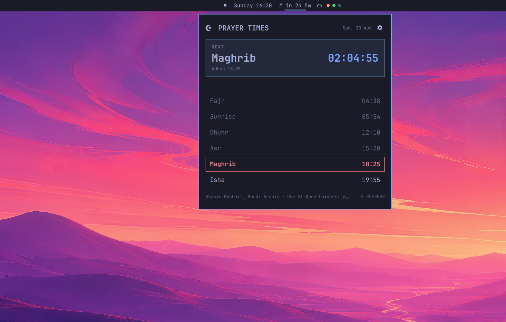

# Prayer Times

A configurable prayer-time bar widget and daily schedule for Omarchy Quattro.
It detects your location automatically by default, caches prayer data for
offline use, and follows the widget when you place it on the left, center, or
right side of the bar.



## Features

- Automatic location detection, with searchable manual city selection
- Prayer times from the AlAdhan API with an offline cache
- Calculation method, madhab, high-latitude rule, Ramadan Isha adjustment,
  Hijri date adjustment, and per-prayer minute offsets
- Four bar formats: `Asr 15:24`, `Asr in 3m`, `A 15:24`, and `A in 3m`
- Optional crescent icon in the bar
- Live next-prayer countdown and complete daily schedule
- `now` at adhan time and `Nm ago` for the first 20 minutes afterward in the
  two relative display modes
- Theme-native settings and panel UI

## Requirements

- A current Omarchy Quattro installation
- Python 3 and `curl`, both included by Omarchy
- Internet access for the first location and prayer-time lookup

## Install

```sh
omarchy plugin add https://github.com/idr4n/omarchy-prayer-times.git --enable
```

The installer prompts you to place the widget on the **left**, **center**, or
**right** side of the bar. The attached panel opens below the selected
position. You can move it later without reinstalling:

```sh
omarchy bar move io.github.idr4n.prayer-times --section left
omarchy bar move io.github.idr4n.prayer-times --section center
omarchy bar move io.github.idr4n.prayer-times --section right
```

## Controls

| Input | Action |
| --- | --- |
| Left click | Open or close the daily prayer panel |
| Right click | Cycle through the four bar text formats and save the choice |
| Middle click | Refresh prayer data |
| Settings button, `S`, `,`, or `Ctrl+,` | Open or close settings |
| `R` | Refresh prayer data while the panel is open |
| `Escape` | Return from settings, then close the panel |

## Settings

Location detection is automatic by default. The settings panel can switch to a
searchable manual city and configure:

- calculation method;
- madhab (`Standard` or `Hanafi`);
- high-latitude adjustment;
- Umm al-Qura Ramadan Isha adjustment;
- Hijri date adjustment from -2 to +2 days;
- minute offsets from -15 to +15 for Fajr, Sunrise, Dhuhr, Asr, Maghrib, and
  Isha;
- bar text format; and
- crescent icon visibility.

Absolute formats always show clock time. Relative formats count down to the
next prayer, show `now` at adhan, and show elapsed minutes for 20 minutes after
adhan before advancing to the next prayer.

## Network access and stored data

Omarchy plugins run unsandboxed inside the existing shell. Prayer Times makes
HTTPS requests to:

- `ipwho.is` over IPv4 for automatic city, coordinates, and timezone detection;
- `api.aladhan.com` for prayer times; and
- `geocoding-api.open-meteo.com` only when you search for a manual city.

Automatic location is re-detected at startup, hourly, after the computer wakes
from sleep, when you switch back to automatic, and when you refresh manually
(middle click, or `R` or Enter in the panel). The last detected location and
prayer responses are kept for offline use. Settings are written atomically
with mode `0600` and are never sent anywhere except as calculation parameters
to AlAdhan.

IP geolocation is approximate. Mobile roaming and travel eSIMs often route
traffic through another country, as do VPNs, so the detected city can be far
from where you are. Use manual city search when an ISP, roaming carrier, or VPN
endpoint is mapped somewhere else.

Stored files:

- `${XDG_CACHE_HOME:-$HOME/.cache}/omarchy/prayer-times/`
- `${XDG_STATE_HOME:-$HOME/.local/state}/omarchy/settings/prayer-times.json`

The plugin requests no elevated privileges, installs no service, and starts no
separate long-running process.

## Remove

```sh
omarchy plugin remove io.github.idr4n.prayer-times
```

Removal intentionally leaves settings and cached responses in place. Delete
them only if you also want to reset all saved choices and offline data:

```sh
rm -rf "${XDG_CACHE_HOME:-$HOME/.cache}/omarchy/prayer-times"
rm -f "${XDG_STATE_HOME:-$HOME/.local/state}/omarchy/settings/prayer-times.json"
```

## Development

Run the contract tests, QML linter, and manifest validator from the repository
root:

```sh
node tests/prayer-logic.js
python3 tests/test_prayer_times_plugin.py
qmllint -I "${OMARCHY_PATH:-/usr/share/omarchy}/shell" \
  BarWidget.qml Panel.qml PrayerService.qml PrayerSettings.qml
omarchy plugin validate .
```

Panel hover suppression must use `bar.setCenterHoverRevealSuppressed(...)`;
the current Omarchy plugin bar API exposes the corresponding state as read-only.
After shell updates, verify shortcut opening, repeated toggling, Escape,
outside-click dismissal, and closing from settings against the live shell.

Before release, also exercise automatic and manual locations, every bar text
format, settings persistence, offline cache fallback, shell restart, and all
three bar placements against a current Omarchy Quattro installation.

## Data sources

Prayer calculations are provided by [AlAdhan](https://aladhan.com/prayer-times-api),
automatic location by [IPWHOIS.io](https://ipwhois.io/), and manual city search by
[Open-Meteo Geocoding](https://open-meteo.com/en/docs/geocoding-api).

## License

[MIT](LICENSE)
